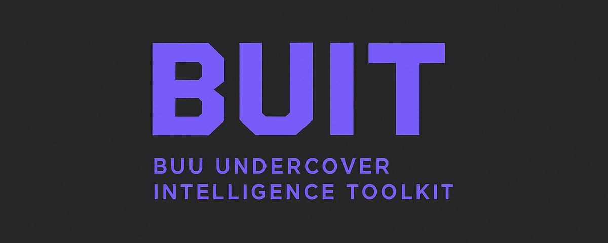
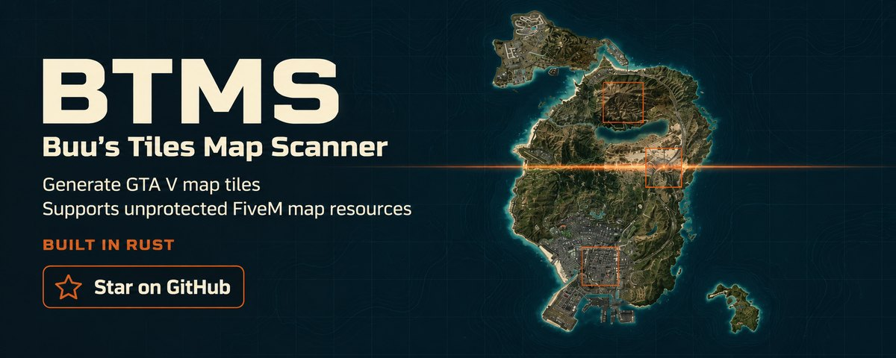

<picture>
  <source media="(prefers-color-scheme: dark)" srcset="assets/header-dark.svg">
  <source media="(prefers-color-scheme: light)" srcset="assets/header-light.svg">
  
</picture>

  
  
  

## About me

I'm **Buu** (BuuDevOff), an IT enthusiast and software developer / architect. I wrote my first lines of code at **7**, making games in Lua and JavaScript on Garry's Mod, and never stopped. Today I build **fast native tools in Rust** and **full-stack web platforms in TypeScript**, often for gaming communities.

- 🦀 **Now:** shipping [BTMS](https://github.com/BuuDevOff/BTMS) and building **BuuDevOff.fr**, my own platform, in Rust and Next.js
- 🧠 **Into:** clean architecture, real-time systems, GPU rendering and local AI (LLMs, RAG, MCP)
- 📚 **Learning daily:** IT, code and project management
- 🎮 **Off-screen:** gaming and exploring new places

## Featured open source

### 🔍 [BUIT](https://github.com/BuuDevOff/buit) · Buu Undercover Intelligence Toolkit

A fast **OSINT toolkit written in Rust** for security researchers. More than 25 reconnaissance modules (username and email lookups, subdomain enumeration, IP analysis and more) in a single command-line tool, released for Windows, macOS and Linux.

  
  
  
  
  

### 🗺️ [BTMS](https://github.com/BuuDevOff/BTMS) · Buu's Tiles Map Scanner

Turns the **whole GTA V map into web map tiles**, straight from the game files on disk, with a FiveM server's unprotected map resources drawn on top. Offline and read-only, **GPU-accelerated through wgpu** (DirectX 12 or Vulkan) with a CPU fallback, re-renders only what changed, and writes a viewer page ready to upload. Comes with an installer and a local interface in 7 languages.

  
  
  
  
  

### 🤝 Contributions

- [**Deformation-Addon**](https://github.com/Ty4a925/Deformation-Addon/pull/2): added the French translation (merged). A Garry's Mod addon in Lua, where it all started for me.

## Selected private work

Most of my day-to-day work lives in private repositories, built for teams and communities. A few highlights:

- **Community platforms** · *2026 · 500+ commits* 
  Two full-stack apps for Garry's Mod roleplay communities. React, Vite and Tailwind on the front end; Node and Express with binary RPC over WebSocket (MessagePack), Prisma, Discord OAuth2 and a Discord bot on the back end. The latest one adds a local LLM assistant (llama.cpp) with hybrid RAG, meeting transcription, an MCP server and Web Push.
- **Multi-bot Discord manager** · *2024 – 2025 · 400+ commits* 
  Runs many Discord bots from one place: TypeScript, discord.js 14, TypeORM and MySQL, AES-256 encrypted token storage, bitwise permissions, and an Angular 19 PWA dashboard.
- **BuuDevOff.fr** · *2026 · in progress* 
  My personal brand and agency platform: a Rust monorepo (axum, tokio) with a hexagonal core, an in-process event bus and SurrealDB live queries, a Next.js front end in English, French and Dutch, shipped with Docker Compose, Caddy and GitHub Actions.
- **FiveM roleplay framework** · *2023* 
  A custom TypeScript framework for a GTA V roleplay server.

## Tech stack

  
  
  
  
  
  
  
  
   
  
  
  
  
  
  
  
  
   
  
  
  
  
  
  
  
  
   
  
  
  
  
  
  
  

## GitHub activity

  <picture>
    <source media="(prefers-color-scheme: dark)" srcset="https://streak-stats.demolab.com?user=BuuDevOff&hide_border=true&background=00000000&ring=FF2E88&fire=FF2E88&currStreakNum=FFFFFF&sideNums=FFFFFF&currStreakLabel=FF2E88&sideLabels=D9D4E7&dates=9A93AD&stroke=3B3550">
    <source media="(prefers-color-scheme: light)" srcset="https://streak-stats.demolab.com?user=BuuDevOff&hide_border=true&background=00000000&ring=D1146A&fire=D1146A&currStreakNum=14101F&sideNums=14101F&currStreakLabel=D1146A&sideLabels=3B3550&dates=5B5670&stroke=E9E3F1">
    
  </picture>

  <picture>
    <source media="(prefers-color-scheme: dark)" srcset="https://raw.githubusercontent.com/BuuDevOff/BuuDevOff/output/snake-dark.svg">
    <source media="(prefers-color-scheme: light)" srcset="https://raw.githubusercontent.com/BuuDevOff/BuuDevOff/output/snake-light.svg">
    
  </picture>

---

  If one of my tools helped you, a ⭐ on its repository goes a long way.
    
  

